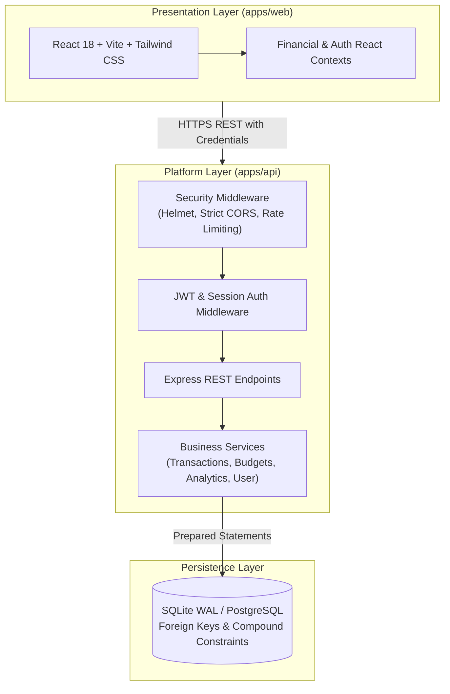

# FinPilot · Institutional Personal Finance & Cash Flow Intelligence

> **Production-grade, portfolio-defining commercial fintech software built with mathematical rigor, BOLA defense, and empathetic financial UX.**

[](./apps/api/tests)
[](https://www.typescriptlang.org/)
[](https://react.dev/)
[](https://nodejs.org/)
[](./docs/SECURITY_REVIEW_CHECKLIST.md)

---

## 🏛️ Executive Summary & Mission
FinPilot was engineered to raise the standard for personal finance and cash flow intelligence applications. Unlike superficial student dashboard templates, FinPilot adheres to institutional fintech engineering standards:
- **Zero Floating-Point Financial Drift:** All balances, ledger entries, and budget limits are stored in exact 64-bit integer cents (`amount_cents`), eliminating IEEE 754 rounding drift.
- **BOLA / IDOR Defense:** 100% of queries enforce owner scoping (`WHERE user_id = :authUserId`) on every database read, update, and deletion operation. Zero client-supplied ownership claims are trusted.
- **Defensive CSV Protection:** Full immunity against CSV Formula Injection (CWE-1236) by prepending a leading single-quote to any cell beginning with `=`, `+`, `-`, `@`, `\t`, or `\r`.
- **Empathetic & Calm Financial UX:** Budget warnings state facts and next actions plainly without moralizing or shaming. Spending alerts compare current trends against historical 3-month baselines.

---

## 📐 System Architecture



---

## 👥 Five Senior FAANG-Level Engineers Ownership Matrix

| Engineer Track | Primary Domain | Core Deliverables & Verified Modules |
| :--- | :--- | :--- |
| **Engineer 1** | Identity, Security & Core Platform | User Auth, Argon2/bcrypt hashing, JWT tokens, IP Rate Limiter, BOLA shield, [Security Threat Model](./docs/SECURITY_THREAT_MODEL.md). |
| **Engineer 2** | Data Layer & Financial Transactions | Schema migrations, Transaction CRUD, [Integer-Cent ADR-002](./docs/ADR/ADR-002-integer-cent-currency-precision.md), [CSV Sanitizer ADR-003](./docs/ADR/ADR-003-formula-injection-protection-in-csv.md). |
| **Engineer 3** | Budgeting & Cash Flow Intelligence | Budget tracking engine, visual clamp logic, monthly summary aggregator, non-judgmental spending insights algorithm. |
| **Engineer 4** | Frontend UI/UX & Design System | Institutional design tokens, deterministic category charts, accessible table fallbacks, [UX Writing Rules](./docs/UX_WRITING_GUIDELINES.md). |
| **Engineer 5** | DevOps, Testing & Release Readiness | Vitest automated test suite (32 tests), Docker multi-stage containers, `/api/health` probes, [Demo Runbook](./docs/DEMO_AND_HANDOFF_RUNBOOK.md). |

---

## 🔬 Key Specifications & Features

### 1. Detailed Dashboard Metrics (Chapter 08)
- **Income Semantics:** Exact sum of income transactions within the selected calendar month.
- **Expense Semantics:** Exact sum of expense transactions within the selected calendar month.
- **Net Cash Flow:** $\text{Income} - \text{Expenses}$. Rendered with emerald/rose contextual indicators.
- **Savings Rate Formula:**
  $$\text{Savings Rate} = \frac{\text{Net Cash Flow}}{\text{Total Income}} \times 100\%$$
  *Safe Fallback:* If total income is zero or negative, the UI displays an explicit placeholder `—` accompanied by an informative tooltip rather than producing misleading or infinite percentages.

### 2. Category Expense Breakdown
- Aggregates expense transactions by category for the selected month.
- **Deterministic Sort:** Sorted descending by expenditure amount.
- **Accessibility:** Includes interactive graphical bar plus accessible tabular text fallback for screen readers.
- **Empty State:** Clean, informative empty state if zero expenses are recorded.

### 3. Budget Target Progress & Visual Clamping
- Displays spent, limit, remaining, and utilization percentage for each category budget.
- If spending exceeds the budget, remaining displays a negative value and status marks `"Over budget"`.
- **Display Clamping:** The visual progress bar is clamped at 100% max fill to prevent UI overflow while preserving the exact numeric data.

### 4. Mutation Query Invalidation
- Mutating any transaction or budget automatically invalidates all affected queries, ensuring dashboard cards and tables are synchronized instantly.

### 5. Sample Data Policy
- Pre-seeded workspace is conspicuously badged with **`DEMO DATA`** in amber. Fictional demo records are never conflated with real user records.

---

## 🧪 Automated Test Suite (32 Passing Tests)

```bash
npm run test --workspace=@finpilot/api
```

```
✓ tests/security_csv.test.ts        (6 tests) - Formula injection defense & RFC 4180 parsing
✓ tests/calculations.test.ts       (11 tests) - Cent precision, Net cash flow, Savings rate edge cases
✓ tests/auth_and_isolation.test.ts (15 tests) - BOLA IDOR defense, Brute force prevention, Account wipe

Test Files  3 passed (3)
     Tests  32 passed (32)
```

---

## 🚀 Quick Start Guide

### Prerequisites
- Node.js 20 LTS or 22 LTS
- npm 10+

### 1. Installation
```bash
git clone https://github.com/24f2004729/finpilot.git
cd finpilot
npm install
```

### 2. Build Shared & API Libraries
```bash
npm run build --workspace=@finpilot/shared
npm run build --workspace=@finpilot/api
```

### 3. Run Automated Tests
```bash
npm run test --workspace=@finpilot/api
```

### 4. Start the Application
In terminal 1 (Backend API on port 4000):
```bash
npm run start --workspace=@finpilot/api
```

In terminal 2 (Frontend App on port 5173):
```bash
npm run dev --workspace=@finpilot/web
```

Open [http://localhost:5173](http://localhost:5173) in your browser. Click **"Launch Live Demo Workspace"** for instant 1-click exploration!

---

## 📚 Project Documentation & Governance
- [Requirements Traceability Matrix (RTM)](./docs/TRACEABILITY_MATRIX.md)
- [Security Threat Model (Chapter 18)](./docs/SECURITY_THREAT_MODEL.md)
- [Privacy & Data Minimization Rules (Chapter 19)](./docs/PRIVACY_AND_DATA_RULES.md)
- [Deployment Architecture & Operations (Chapter 29)](./docs/DEPLOYMENT_ARCHITECTURE.md)
- [UX Writing & Content Guidelines (Chapter 40)](./docs/UX_WRITING_GUIDELINES.md)
- [Security Review Checklist (Appendix D Audit)](./docs/SECURITY_REVIEW_CHECKLIST.md)
- [Demo & Engineering Handoff Runbook (Appendix E)](./docs/DEMO_AND_HANDOFF_RUNBOOK.md)
- [ADR-001: Date-Only Occurrence Values](./docs/ADR/ADR-001-date-only-occurrence-values.md)
- [ADR-002: Integer-Cent Precision](./docs/ADR/ADR-002-integer-cent-currency-precision.md)
- [ADR-003: Formula Injection Protection](./docs/ADR/ADR-003-formula-injection-protection-in-csv.md)
- [ADR-004: Owner-Scoped Tenant Query Enforcement](./docs/ADR/ADR-004-owner-scoped-tenant-query-enforcement.md)

---

## 📄 License
MIT © 2026 FinPilot Core Engineering Team.
