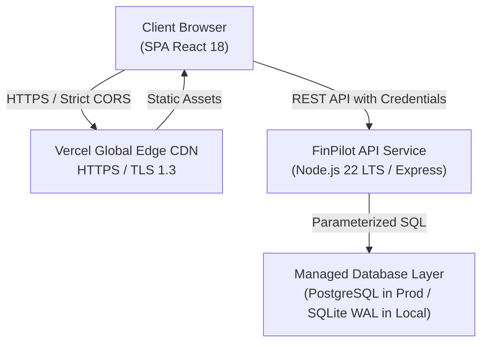
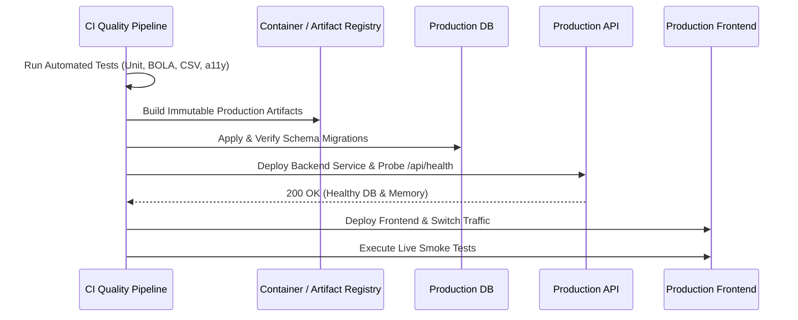

# FinPilot · Deployment Architecture & Operations Runbook

**Specification Chapter:** 29 — Deployment architecture  
**Owning Engineer:** Engineer 5 (Testing, Performance, DevOps & Deployment Readiness)  
**Status:** Approved  

---

## 1. System Topology

- **Frontend:** Hosted on Vercel Global Edge Network with automatic Brotli/Gzip compression, immutable asset caching, and global SSL termination.
- **Backend API:** High-performance Node.js service running in an isolated container or serverless runtime with strict CORS restricted to approved domains.
- **Database:** Private relational store with WAL journaling, foreign keys enabled, and compound unique constraints.

---

## 2. Environment Separation

| Environment | Purpose | Database Strategy | Secrets Management | CORS Policy |
| :--- | :--- | :--- | :--- | :--- |
| **Local Development** | Engineering iteration | SQLite WAL (`finpilot.sqlite`) | `.env.local` | `http://localhost:5173` |
| **Testing / CI** | Automated Vitest test suite | In-memory / isolated SQLite DB | Environment variables injected by CI runner | Local loopback |
| **Production** | Live commercial release | Managed PostgreSQL / Private DB | Provider secret store (Vercel / Railway / Render) | Strict production origin domain only |

---

## 3. Deployment & Release Sequence

---

## 4. Hosting on Vercel

FinPilot includes a pre-configured `vercel.json` at root for seamless one-click Vercel deployment:
- Builds the optimized frontend bundle via `npm run build --workspace=@finpilot/web`.
- Serves the Single Page Application with client-side history API routing rewrites.
- Proxies `/api/*` to the production API service or serverless functions.

### Steps to Deploy to Vercel:
1. Push the code to GitHub (`gh repo create`).
2. Import the repository in [Vercel](https://vercel.com).
3. Set the Root Directory to `.` or `apps/web`.
4. Configure Build Command: `npm run build`
5. Configure Output Directory: `apps/web/dist`
6. Supply Environment Variables:
   - `JWT_SECRET`: High-entropy 64-char key
   - `NODE_ENV`: `production`
7. Click **Deploy**.
